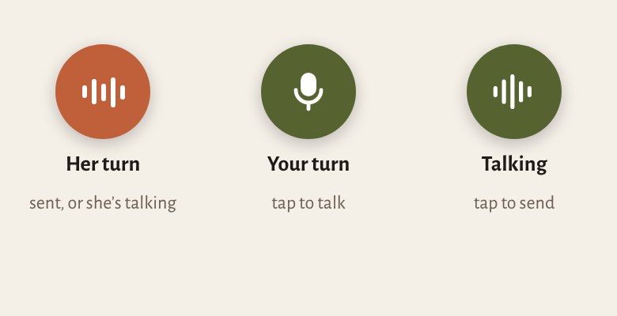
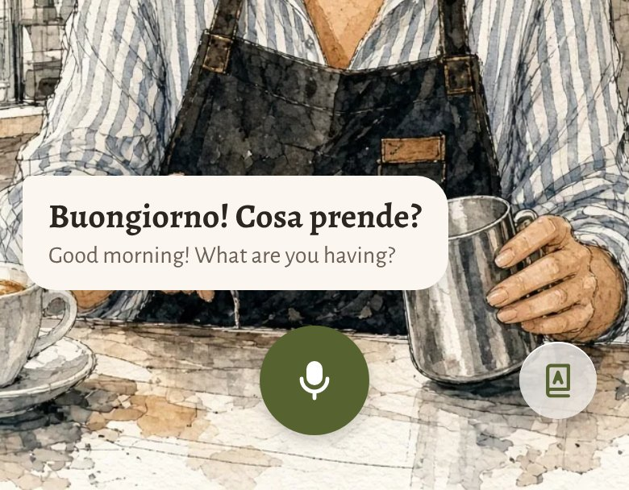
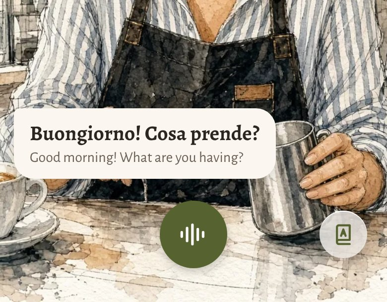
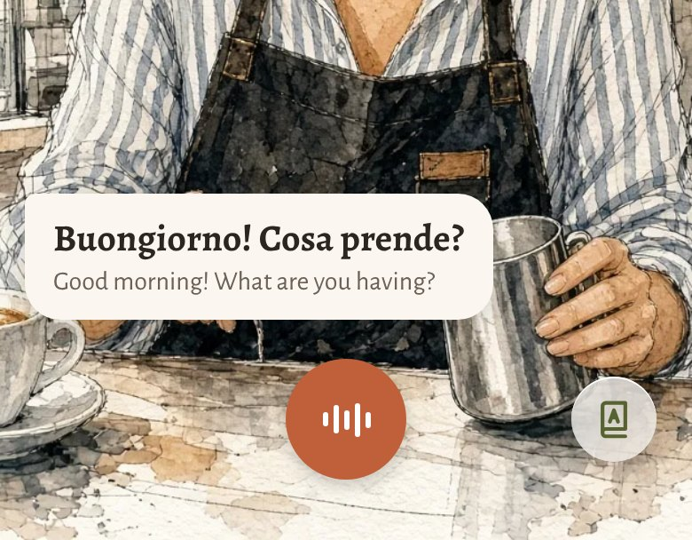

# Bottom bar: one circle, three states

2026-10-22 · Josh · Decided with the cloud session on the design canvas ("Reply buttons", row F: https://claude.ai/artifact/X2FsYUrGWzXzf2tJxBALBV). **Not built.** For every conversation screen, scaffolding or not.

## Decisions (Josh)

- **One circle, always.** The pill goes; the circle keeps its size and place in every state, only its fill and glyph change.
- **Three states:**

  | State | Circle | A tap |
  |---|---|---|
  | **Her turn**: from the moment you send until she finishes speaking | terracotta, moving dots | cuts in and starts your turn (as today) |
  | **Your turn** | green, mic | starts talking |
  | **Talking** | green, sound wave moving with your voice | sends |

- **No Pause and no Play/Resume, anywhere** (Josh: "complexity before anyone asks for it"; the Pause and Resume safeguards were rules a computer wrote). A call, Siri, AirPods coming out or backgrounding just ends what was happening and leaves you on **your turn**; the mic never reopens without a tap. A failed step shows its message and leaves you on your turn too.
- **Nothing else in the bar but the Learn link** ([learn.md](learn.md)): a 48 pt glass circle on the right, its centre on the circle's centre line, 6 pt in from the 48 pt column at the edge. Same place in every state, so it's never a moving target. Before there's anything to learn, the right side is empty.

| Your turn | Talking | Her turn |
|---|---|---|
|  |  |  |

## Sizes and colours

- Circle 68 pt (the canvas; 64–72 is fine), centred, about 34 pt above the bottom edge; soft shadow.
- Green `Tokens.Colors.green` (#566330) with white glyphs; terracotta `Tokens.Colors.terracotta` (#C0603A) with white dots. Glyphs: `mic.fill`, a live level waveform, the existing `LevelDots`.
- Reduce Motion: the dots and the wave hold still.
- Accessibility labels: "Tap to talk", "Tap to send", "Stops her and starts your turn".

## What changes in the code (for the laptop)

- `ConversationControls.swift`: the pill becomes the circle; remove the Pause/Resume button and the stop square; `pillFill` maps your turn and talking to green, her turn (speaking and thinking) to terracotta.
- Interruptions and failures go to your turn (`tapToTalk`) instead of a paused state; hands-free keeps reopening the mic by itself between turns, with no Pause.
- CLAUDE.md's safeguard line is updated in the same commit as this doc.

## Done means

Played on Josh's iPhone in both countries, tap-to-talk and hands-free; a call, Siri, AirPods out and backgrounding each land on your turn with the mic closed; AX5; VoiceOver.
