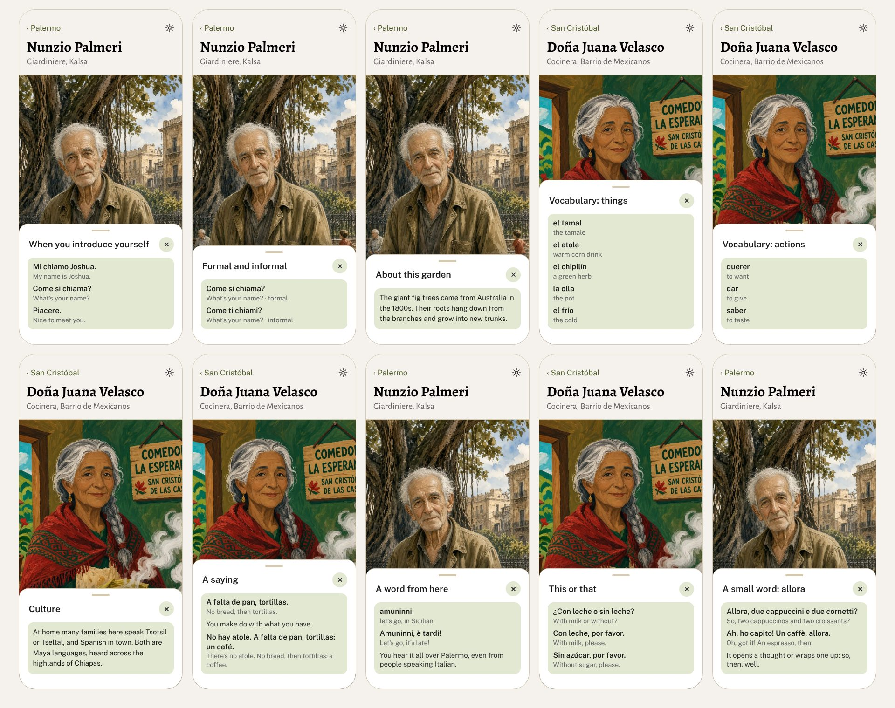
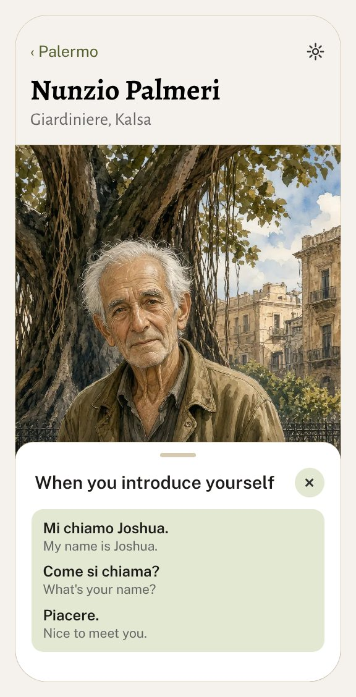
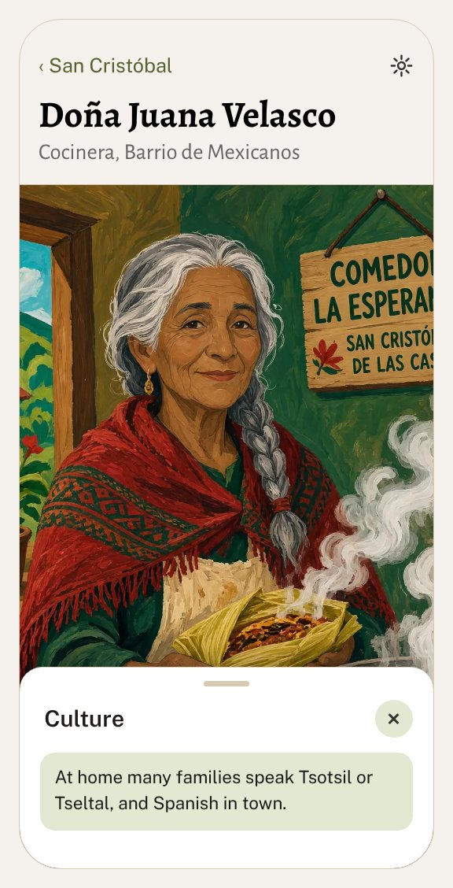
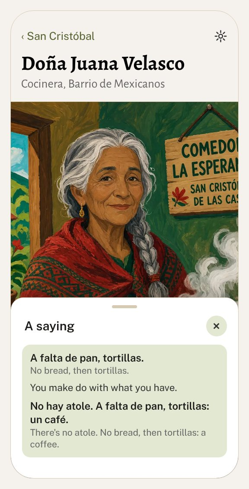

# The learn sheet: design

2026-11-23 · Josh's design, written up by the cloud session at his request ("supply a written design document and the 10 example cards - go into any depth you choose on how you might implement them but be clear the tech design is open").

**Status:** the design below is Josh's, settled in mock-ups. Nothing is built. **The technical design at the end is open:** it is one way this could be made, written to show the design can be supplied from what the game already has. None of it is decided.

How the design got here, round by round, with what was tried and dropped: [learn-sheet-2.md](learn-sheet-2.md). The mock-up page: "Lesson Door Sheet" (https://claude.ai/artifact/XVeopuYsxXoP2ibkiSwunm).



## What it is

After a visit, when the character has said goodbye, a sheet slides up with one card on it. The card **instructs**: it reinforces vocabulary, grammar or something about the country, in a few lines. It is a quick look, not something to work through. The learner reads it, closes it, and is back at the city's place list.

Josh: "the sheet is to instruct"; "the learn page is only about reinforcing vocab, grammar, etc"; "this is a quick review moment - not a deep user interaction".

## The moment

"The character says good bye - the card stays - the sheet slides up - closing returns to place list."

1. The character says goodbye on the standard person screen.
2. That screen stays exactly as it is: the back button, the settings button, the name band, the portrait. The sheet slides up over its lower part.
3. Closing the sheet returns to the place list.

**Leaving the sheet** (Josh, 2026-11-23: "yes"). The conversation is over, so every way out ends on the place list, never on the person screen:

| Exit | Goes to |
|---|---|
| ✕ close | the place list |
| Sliding the sheet down (the standard gesture, kept) | the place list |
| A tap off the sheet, on the dimmed person screen, the back button included | the place list |
| The back swipe from the edge | not available while the sheet is up; slide or tap it away first |
| A timer | none: a card doesn't close itself mid-read |
| Backgrounding or locking the phone | the sheet is still there on return |

## The card is the sheet

One sheet, one card (Josh: "the card is the sheet. 1:1"). There is never a second card under the first, and no footer.

| Part | What it is |
|---|---|
| Headline | At the top of the sheet, level with the close button. It names the card: "When you introduce yourself", "Vocabulary: things". |
| Close button | Small and round, top right. The only control. No Done at the bottom. |
| Body | One sage green block (#e2e8d2) under the headline, holding the card's lines. |
| Lines | The language line in ink, semibold; the English under it, smaller and muted. Fact cards hold one short paragraph instead. Some cards add one plain line in English: a saying's meaning, what a small word does. |

No picture inside the sheet: the person is on the screen behind it. The sheet may cover the face when a card is tall; the name band still shows (Josh: "you haven't lost context").

## Rules

1. **One topic per card, and nothing under it.**
2. **One style for every type.** The sage block with rows of text. No tiles, bubbles, bands or boxes inside it.
3. **Card types are never combined** into one card.
4. **Whole sentences, no blanks** on phrase cards.
5. **The English goes under each line**, not beside it.
6. **Lines run in the order they're said:** the question, then the answer.
7. **Plain.** No audio, no replayed moments, nothing about the next visit, no city or day of the week, no red.
8. **Bite-sized, but not sparse.** About three lines to a card: two or three phrases, five things, three actions, a fact of two or three sentences. Josh, of the first drawings of Culture, A saying, A word from here, This or that and A small word, which held one or two lines: "the bottom row of 10 is sparse"; they were filled out to match. Earlier, fuller cards were "too dense" and one-line pointers "too compact".
9. **Cards are often picked by what the conversation involved, but not always.** A card can stand by itself.
10. **The person screen behind the sheet is not changed.**
11. **Cards don't make corrections** (Josh, 2026-11-23: "i don't know if it made it into the design doc - but cards don't make corrections"). A card shows the right way to say things; it never shows what the learner got wrong or a wrong form beside the right one.
12. **No adornment** (Josh, 2026-11-23: "we can skip the adornment - for vocabulary - lose things/verbs/actions -- just translate Vocabulary"): no mark, label, badge or stamp for the kind of card; the plain card stands. Mock-ups of four treatments: https://claude.ai/artifact/KsCwLuDkhdeooz28zpkjDD.
13. **One Vocabulary card**, headed "Vocabulary": the visit's words, each with its English, nouns and verbs in any mix; Vocabulary: things and Vocabulary: actions are folded into it (same words).
14. **The card for a much-used word** (what was "A small word"; Josh, 2026-11-23: "id start the card explaining why its important and then give examples"; then, of *ma dai*: "no way, i've had it, i can't believe it"): first a plain line on why the word matters, then the word at work, one example for each meaning people really use. One word per card: *ma dai* and *dai* are two cards. Headline: "Learn it:" followed by the word, as in "Learn it: ma dai" (Josh, 2026-11-23: "use \"Learn it:\" as the header followed by the word"; drawn: https://claude.ai/artifact/Qg446dBRTF4WbwhsFTcTds). Josh, after the mock-ups: "i think the cards are improved enough".

## Next version: the visit's own content, in this form (2026-11-24)

**What prompted it.** Josh's six Mexico visits of 2026-11-23, the first evening with cards live (Regina 4335c671, Baldemar 78e59d51, Adrián 9a714451, Ismael 63afafc2, Abel 4955c6e5, Refugio d2e77f56). Three ended on a card, three on nothing. Josh: "it seems like learn 1.0 has superior form than 2.0"; then "a shortcoming of 1.0 is the content is dense and predictable - a goal of 2.0 was to lighten it up in design, and vary wwhat you see".

**The six visits, both versions:**

| Visit | Learn 2.0 card shown | End-of-visit learning notes (three phrases each; not the Learn 1.0 page, see the correction below) |
|---|---|---|
| Regina, Macroplaza | About this plaza: opened 1984, 40 hectares, Barragán's lighthouse (a bank fact; no language) | *Venga otro lunes y le enseño el dibujo terminado* · *Todavía no lo termino* · *Que le vaya muy bien* |
| Baldemar, cabrito | A saying: *no hay bronca*, "there's no fight", note "No problem." | *no hay bronca* · *Ahorita le sirvo* · *Vuelva el domingo* |
| Adrián, records | none (a level-up visit) | *Le recomiendo* · *Ahorita lo pongo* · *Venga el sábado* |
| Ismael, Morismas | When someone offers to show you something: *¿Le gustaría ver el traje?* / *Sí, me gustaría verlo.* / *No, gracias.* (made from the visit) | *vuelva a verme* · *se hace con paciencia* · *sirve para* |
| Abel, tamborazo | none (the writer chose none; the bank fill-in was blocked by the three-visit rule) | *una sopa de su propio chocolate* · *¿Le gustaría escuchar…?* · *Llevo veinte años tocando* |
| Refugio, cantera | none (a level-up visit; the offer was then lost, docs/bugs.md B62–B63) | *¿Quiere tocar la piedra?* · *Venga otro día* · *Fue un gusto platicar con usted* |

**Correction (2026-11-24, later the same day).** The third column is not the Learn 1.0 page. It is the learning notes the end of every visit writes for the study file and the Learn area (`conversations.review.items`, lib/memory.ts), which the learner never sees. The Learn 1.0 page (the Learn link, lib/learn.ts) holds corrections, the visit's words (things and actions) and one "good to know", and it isn't stored, so what it showed on these visits can't be read back. What follows compares the cards with those notes; the notes are still written for every visit and are visit-tied raw material.

**What each does better.**
- **1.0:** everything comes from the visit, the why is about the learner ("Joshua already uses todavía no"; "they answered it with 'me gustaría', so it's worth reusing"), and it is always language. But it is dense (three phrases and a grammar note each, every time) and predictable: "come back on [day]" with "formal command form" in 5 of the 6 pages, because every wind-down now says it.
- **2.0:** one light card, and a different kind each time. But one of the three came from the bank about the place, not from the visit. The best of the six was Ismael's, made from the visit: a phrase and how to answer it.

**Josh, 2026-11-24, after a comparison of the Learn page and the card:** "I think the \"card bank\" idea took it in a wrong direction. In the table - the source was never a goal - the rest of them were." The goals of 2.0 were the form (after the goodbye, comes to you, light, one kind, varied, no corrections, read and close); where its content comes from was a build choice, and the bank was that choice.

**The goal for the next version:**
- **2.0's form:** one card after the goodbye, of one of the kinds above, light.
- **1.0's source:** built from what was said in the visit. The Learn 1.0 page, already written during every visit (lib/learn-ahead.ts), is raw material, not the thing shown.
- **Variety by kind, across visits:** not the same kind as the last card or two. A place card only when the visit was about the place.
- **The bank as a rare fill-in,** still under the three-visit rule (Josh, 2026-11-24: "do you think we should show 5 backup in a ro even when we have contextual cards").
- **Level up wins** stays (a level-up visit ends on the offer, not a card); it depends on the offer being on screen at the goodbye (docs/bugs.md B63).

Mock-ups of the card each of the six visits could have had, each a different kind: https://claude.ai/artifact/ExmhTxobHySwmFV1gWWFJ6 (not yet judged by Josh).

## The source, redesigned (2026-11-24)

Josh, of the proposal below: "seems like a better design for the source". Not built.

**What the learner sees:** after every goodbye (a level-up visit ends on the offer instead), one light card about the visit just had, and a different kind from the last cards.

**The source is the visit, and what Claude knows about the place.** No bank. The Learn 1.0 page already works this way: its "good to know" is written from the scene and the model's own knowledge ("one cultural or practical point from this scene … about life here", content/<country>/prompts/learn.md), nothing looked up. Facts aren't checked ("a world, not an encyclopedia", CLAUDE.md); the language is: a card's lines in the language are taken from the visit as said (the character's lines, the answers offered), so they are as right as the conversation; new language only for the one extra example a Learn it card needs.

**How:**
1. At the wind-down, one call (the existing writer) reads the visit and fills every kind the visit can support: a situation (When you…), a much-used word heard (Learn it), the saying if one was used, formal and informal if both came up, a word from here if one came up, the visit's words (Vocabulary), and About this place / Culture from the scene (Josh's type: "It doesn't have to come from the conversation").
2. Code, not the model, picks the kind: not a kind shown in the learner's last two cards, then the first left in the order situation, Learn it, saying, formal and informal, word from here, place or culture, Vocabulary (Josh, 2026-11-24: "The situation cardds may be the best"). Variety by code, since an instruction to vary gets the same thing every time (B31).
3. Every visit can fill Vocabulary, so a card is always there.
4. The bank (content/<country>/learn-cards.json), the fill-in and the three-visit rule go: there's nothing generic left to ration (Josh: "I think the \"card bank\" idea took it in a wrong direction"). Lessons may still lend checked phrases to a situation card; not decided.
5. Level up wins (a level-up visit ends on the offer; needs B63).

**Mock-ups:** all nine kinds made this way from Josh's 2026-11-23 Mexico visits, in the app's look (system font, 35 pt close): https://claude.ai/artifact/Hx3j3vT4U9sizfem6E2eJ7 (not yet judged).

**What could go wrong in play:** a card that only repeats what was just heard, too thin to teach; a short visit giving only Vocabulary several times; a made example with an error.

## The ten card types

Each example below is drawn on the full person screen in `design/learn-sheet-2/cards/`.

### 1. When you…

One topic the conversation involved, as that lesson's phrases. The headline is the situation.

- **Holds:** two or three whole sentences from one lesson, in spoken order.
- **Example:** When you introduce yourself. *Mi chiamo Joshua.* My name is Joshua. / *Come si chiama?* What's your name? / *Piacere.* Nice to meet you.
- **Supply:** 77 lessons that aren't about culture; about 66 make a natural "When you…". Eighteen worked examples are in learn-sheet-2.md.



### 2. Formal and informal

The two forms, one above the other, each marked.

- **Holds:** the same sentence twice, formal then informal.
- **Example:** *Come si chiama?* What's your name? · formal / *Come ti chiami?* What's your name? · informal.
- **Supply:** the lessons that teach *tu* and *Lei*, *tú* and *usted*; most lesson examples already come in both forms.


### 3. About this place

One fact about where you were. It doesn't have to come from the conversation. The headline names the place's kind: "About this garden", "About this comedor".

- **Holds:** one or two sentences.
- **Example:** About this garden. The giant fig trees came from Australia in the 1800s. Their roots hang down from the branches and grow into new trunks.


### 4. Vocabulary (5 folded in, 2026-11-23)

- **Holds:** about five words from the visit, each with its English under it: nouns with their article, verbs in the form you'd look up, in any mix. Headed just "Vocabulary" (rule 13).
- **Example:** *el tamal* the tamale / *el atole* warm corn drink / *el chipilín* a green herb / *querer* to want / *dar* to give.
- The two drawings below are from before the merge.


### 6. Culture

One culture fact: how people live there. (About this place is about where you stood; Culture is about the people. They are two types.)

- **Holds:** two or three sentences.
- **Example:** At home many families here speak Tsotsil or Tseltal, and Spanish in town. Both are Maya languages, heard across the highlands of Chiapas.



### 7. A saying

One idiom, its literal words, and what it means.

- **Holds:** the saying, its word-for-word English under it; one plain line with the meaning; then the saying used in a sentence, with its English.
- **Example:** *A falta de pan, tortillas.* No bread, then tortillas. You make do with what you have. / *No hay atole. A falta de pan, tortillas: un café.* There's no atole. No bread, then tortillas: a coffee.



### 8. A word from here

One local word.

- **Holds:** the word and what it means, with the language it comes from when that isn't the one being learned; a sentence that uses it; one plain line on where you hear it.
- **Example:** *amuninni* let's go, in Sicilian / *Amuninni, è tardi!* Let's go, it's late! / You hear it all over Palermo, even from people speaking Italian. (San Cristóbal: *kolaval*, thank you, in Tsotsil.)


### 9. This or that

A choice of two that isn't formal and informal.

- **Holds:** the question that offers the choice, then each answer, built alike so the two read as a pair.
- **Example:** *¿Con leche o sin leche?* With milk or without? / *Con leche, por favor.* With milk, please. / *Sin azúcar, por favor.* Without sugar, please. (Italy: *Buongiorno!* until the afternoon / *Buonasera!* from about four.)
- **Supply:** about 19 lessons teach a choice like this.


### 10. A small word

One little word that does a lot of work. The headline names it: "A small word: allora".

- **Holds:** two sentences that use it, the English under each; one plain line saying what the word does.
- **Example:** *Allora, due cappuccini e due cornetti?* So, two cappuccinos and two croissants? / *Ah, ho capito! Un caffè, allora.* Oh, got it! An espresso, then. / It opens a thought or wraps one up: so, then, well.
- **Supply:** about 12 lessons are about one.


## Not decided in the design

- **A footer.** Two candidates so far, neither on the sheet: Try it (something to say to the next person you meet) and Open the lesson. Open the lesson waits for an overhaul of the lessons (Josh, 2026-11-23: "the lesson link is part of why i added the footnote. I think lessons needs an overhaul before we link to them"); each card's source footnote names its lesson, ready for it (Josh, then: "i don't think the lessons change - I think the presenttion of the lesson material doees"; so lesson-cut cards stay valid and lessons stay a first-pass source).
- **Which card shows** after a given visit, and what happens when a visit gives nothing to pick from.
- **Whether the sheet shows after every visit,** and after one that ends without a goodbye (the back button).
- ~~The old Learn sheet~~ **Settled (Josh, 2026-11-23):** when Learn 2.0 is finished it replaces the Learn link (the book) and the Learn 1.0 sheet; see the scope note in [learn-sheet-2.md](learn-sheet-2.md). Learn 1.0's corrections are not carried over: cards don't make corrections (rule 11).
- **The close button's exact look.**
- Four suggested types Josh did not pick: Vocabulary: descriptions, Numbers, Unlike English, What you'll hear.

---

## How it might be built (open)

**Superseded by the approved plan, [learn-sheet-2-plan.md](learn-sheet-2-plan.md)** (2026-11-23): a card bank cut from the content plus cards made from the visit, one writer call per visit that picks or makes a card or says none, backfill only after 3 visits without a sheet, and an open set of kinds that grows from play. The sketch below is kept as it was.

Everything from here down is the cloud session's sketch, not a decision. It is here to show that each card type can be supplied from content the game already holds, and to name the choices a build would have to make.

### What already exists

| Piece | Where | What it gives |
|---|---|---|
| The goodbye ends the visit | `PersonView`, `.onChange(of: model.phase)`: on `.finished` it waits and dismisses | The exact point where the sheet would come in |
| A sheet over the person screen | `PersonView` already presents `LearnSheet` with `.sheet` | The presentation is there; this is new content in it |
| End of conversation on the server | `POST /v1/conversations/{id}/end` → `lib/remember.ts` | A place that already runs once per visit, with the transcript |
| A word list per conversation | `lib/learn.ts`: `words.things` (word, English, plural) and `words.doing` (infinitive, English, the form said) | Vocabulary: things and Vocabulary: actions, almost as they are |
| Lessons | `lib/lessons.ts`: each step has `how_to`, four `examples` (said, English), `notice`, `practice` | When you…, Formal and informal, This or that, A small word |
| Idioms | `content/<country>/idioms.json` (120 each), `lib/idioms.ts`: `pickIdiom`, `usedIdiom`, `recentIdioms` | A saying, including which idiom a character used in the visit |
| City lists | each city file's `food`, `customs`, `localTouches`; read by nothing in the turn prompt | Culture, A word from here |
| Each person's `here` line | `content/<country>/cities/*.ts`; out of the conversation prompt since 2026-11-23 (header only) | About this place: checked facts about the place, now otherwise unused |
| Culture stories | `content/<country>/culture.json` | More Culture facts |

So no type needs new writing to exist. Several need a short, checked sentence cut from longer text.

### One shape for every card

Because every type is the same block of rows, one data shape covers all ten:

```
card: {
  type: 'when-you' | 'formal-informal' | 'about-place' | 'things' | 'actions'
      | 'culture' | 'saying' | 'local-word' | 'this-or-that' | 'small-word',
  headline: string,            // "When you introduce yourself"
  rows: [{ text, en }],        // language line, English under it
  note?: string                // the plain line: a fact, or a saying's meaning
}
```

The app would draw this with one view: headline, close button, sage block, rows. A new type would then be new content, not new screen work. The headline words are English interface text; anything in the learned language arrives in `rows`, tagged with its language, so nothing Italian or Spanish lives in Swift.

### Where each type's content could come from

| Type | Source | Needs a model call? |
|---|---|---|
| When you… | The lesson whose topic the visit touched: two or three of its `examples`, in order | Only to decide which lesson the visit touched |
| Formal and informal | A lesson example that exists in both forms | No |
| About this place | A sentence or two from the person's `here` line | Once, offline, to cut each line into card-sized facts |
| Vocabulary: things | `words.things` from the conversation's word list, first five | Already made by `lib/learn.ts` |
| Vocabulary: actions | `words.doing`, first three, the infinitive | Already made |
| Culture | The city's `customs` and `food` lists, each written out as a sentence | Once, offline |
| A saying | The idiom the character used this visit (`usedIdiom`), else one from the store at the learner's level | No |
| A word from here | The city's `localTouches` | No, after a tidy of those lists |
| This or that | The lessons that teach a choice of two | No |
| A small word | The lessons about one small word; their examples | No |

Two ways to prepare the content, and a build could mix them:

- **Ahead of time.** Cut cards from lessons, city lists, idioms and `here` lines once, check them, and store them as data in `content/<country>/`. Cheap at visit time, checkable like lessons are, and the same for everyone.
- **At the end of a visit.** Only what depends on the visit: the two vocabulary cards (from the word list), and matching the visit to a lesson or a saying.

### Picking the card

Open, and the main design question left. The pieces a picker would need:

- **What the visit involved.** Which lesson topics came up; which idiom was said; the visit's words. The first is the unknown: it could be a small model call at the end of the visit, or something the turn records as it goes.
- **What this learner has already seen.** A record of cards shown, so a card isn't repeated and a type isn't shown three visits running.
- **A fallback.** When the visit gives nothing (two turns and a goodbye), a card that stands by itself: About this place, Culture, A word from here, A saying.
- **Level.** Beginners mostly tap an offered answer, so their visits map cleanly onto lesson phrases; the later Italian lessons suit higher levels.

A first version could be very plain: prefer a card tied to the visit, never repeat a card, rotate the types. Whether that feels right is for Josh's play to say.

### On the phone

- The sheet would be presented from `PersonView` at the point where it now dismisses after the goodbye; closing it would do what the dismissal does today, through the same leave function.
- Standard sheet behaviour, so swipe-down closes it as well as the button.
- Text from text styles and colours from the tokens, as every screen; the sage would become a token.
- The card would need to be ready when the goodbye ends. Fetching it during the last turn, or sending it with the end-of-conversation answer, are both possible; if it isn't ready, the screen should close as it does today with no sheet, not wait.

### Choices a build would have to make

- Whether cards are stored content, made per visit, or both.
- How a visit is matched to a lesson.
- What to record about cards shown, and where.
- ~~What becomes of the old Learn sheet's corrections~~ None carry over: cards don't make corrections (rule 11).
- Whether the sheet is skipped sometimes, so it doesn't become a ceremony after every goodbye.
- How card content is checked. Lesson lines are already judged; facts cut from `here` lines and city lists would want the same fact check those lines had.

### What isn't known

- Whether learners read the card or close it at once.
- Whether five nouns is the right number on a small phone at large text sizes.
- Whether matching a visit to a lesson can be done reliably without a model call.
