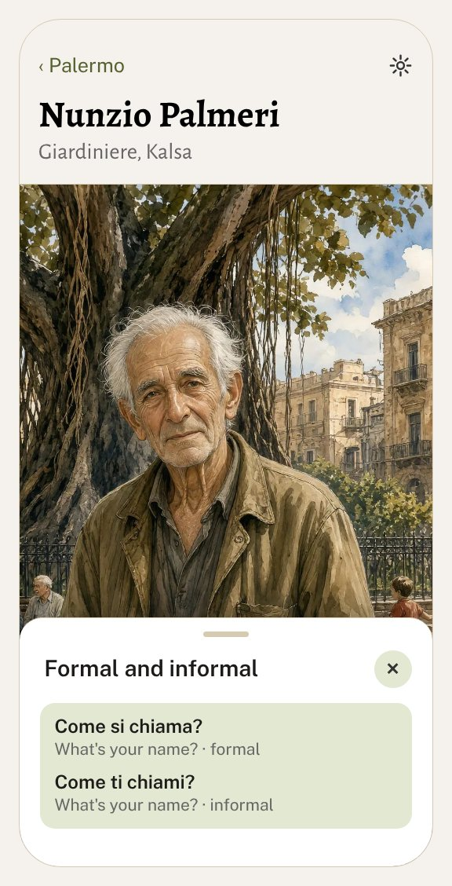
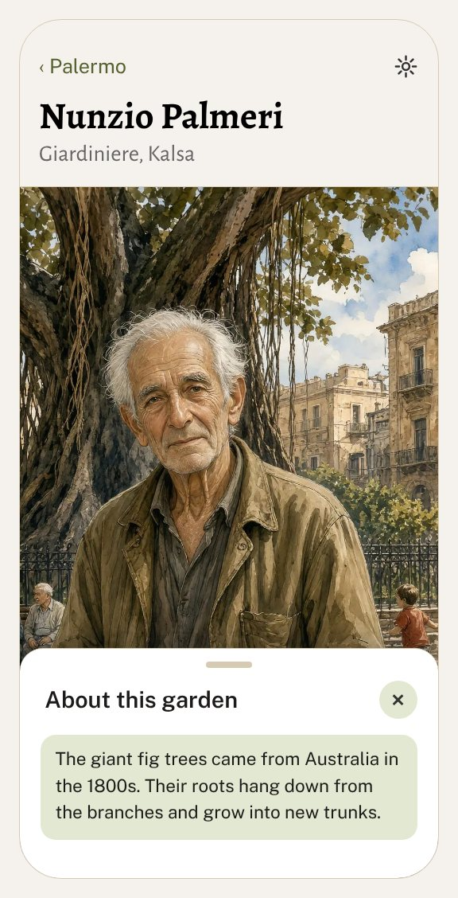
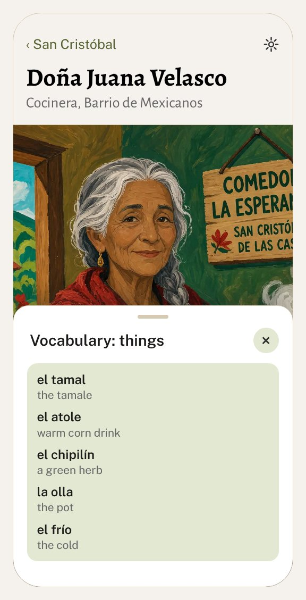
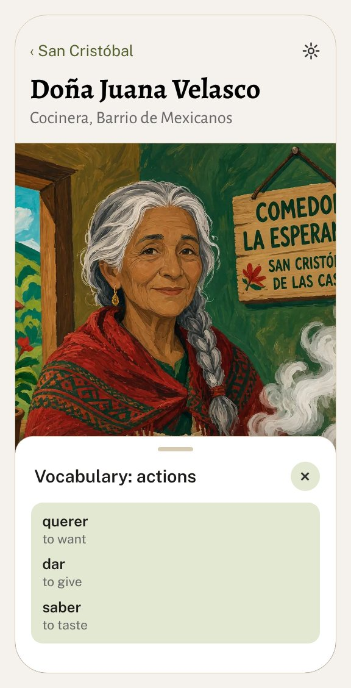
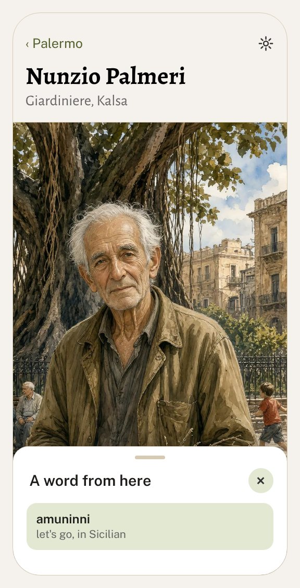
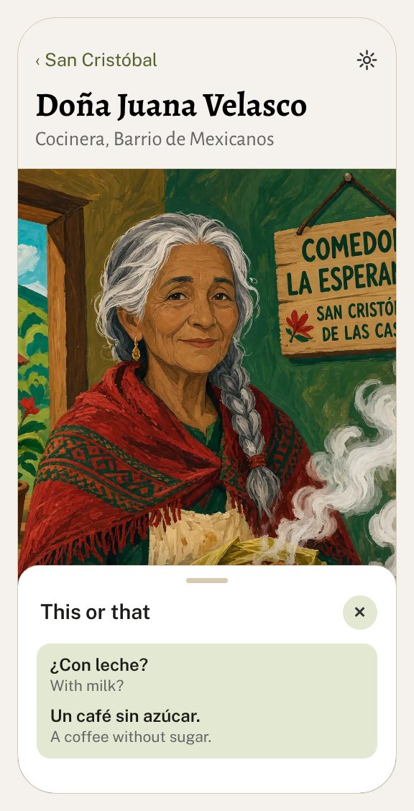
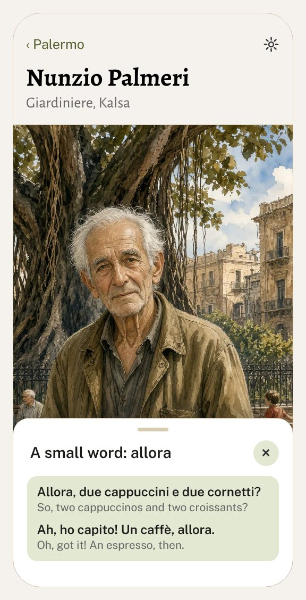

# The learn sheet: design

2026-11-23 · Josh's design, written up by the cloud session at his request ("supply a written design document and the 10 example cards - go into any depth you choose on how you might implement them but be clear the tech design is open").

**Status:** the design below is Josh's, settled in mock-ups. Nothing is built. **The technical design at the end is open:** it is one way this could be made, written to show the design can be supplied from what the game already has. None of it is decided.

How the design got here, round by round, with what was tried and dropped: [learn-sheet-2.md](learn-sheet-2.md). The mock-up page: "Lesson Door Sheet" (https://claude.ai/artifact/XVeopuYsxXoP2ibkiSwunm).


## What it is

After a visit, when the character has said goodbye, a sheet slides up with one card on it. The card **instructs**: it reinforces vocabulary, grammar or something about the country, in a few lines. It is a quick look, not something to work through. The learner reads it, closes it, and is back at the city's place list.

Josh: "the sheet is to instruct"; "the learn page is only about reinforcing vocab, grammar, etc"; "this is a quick review moment - not a deep user interaction".

## The moment

"The character says good bye - the card stays - the sheet slides up - closing returns to place list."

1. The character says goodbye on the standard person screen.
2. That screen stays exactly as it is: the back button, the settings button, the name band, the portrait. The sheet slides up over its lower part.
3. Closing the sheet returns to the place list.

## The card is the sheet

One sheet, one card (Josh: "the card is the sheet. 1:1"). There is never a second card under the first, and no footer.

| Part | What it is |
|---|---|
| Headline | At the top of the sheet, level with the close button. It names the card: "When you introduce yourself", "Vocabulary: things". |
| Close button | Small and round, top right. The only control. No Done at the bottom. |
| Body | One sage green block (#e2e8d2) under the headline, holding the card's lines. |
| Lines | The language line in ink, semibold; the English under it, smaller and muted. Fact cards hold one short paragraph instead. |

No picture inside the sheet: the person is on the screen behind it. The sheet may cover the face when a card is tall; the name band still shows (Josh: "you haven't lost context").

## Rules

1. **One topic per card, and nothing under it.**
2. **One style for every type.** The sage block with rows of text. No tiles, bubbles, bands or boxes inside it.
3. **Card types are never combined** into one card.
4. **Whole sentences, no blanks** on phrase cards.
5. **The English goes under each line**, not beside it.
6. **Lines run in the order they're said:** the question, then the answer.
7. **Plain.** No audio, no replayed moments, nothing about the next visit, no city or day of the week, no red.
8. **Bite-sized.** Two or three lines for phrases, five for things, three for actions, one fact. Earlier, fuller cards were "too dense" and one-line pointers "too compact".
9. **Cards are often picked by what the conversation involved, but not always.** A card can stand by itself.
10. **The person screen behind the sheet is not changed.**

## The ten card types

Each example below is drawn on the full person screen in `design/learn-sheet-2/cards/`.

### 1. When you…

One topic the conversation involved, as that lesson's phrases. The headline is the situation.

- **Holds:** two or three whole sentences from one lesson, in spoken order.
- **Example:** When you introduce yourself. *Mi chiamo Joshua.* My name is Joshua. / *Come si chiama?* What's your name? / *Piacere.* Nice to meet you.
- **Supply:** 77 lessons that aren't about culture; about 66 make a natural "When you…". Eighteen worked examples are in learn-sheet-2.md.


### 2. Formal and informal

The two forms, one above the other, each marked.

- **Holds:** the same sentence twice, formal then informal.
- **Example:** *Come si chiama?* What's your name? · formal / *Come ti chiami?* What's your name? · informal.
- **Supply:** the lessons that teach *tu* and *Lei*, *tú* and *usted*; most lesson examples already come in both forms.



### 3. About this place

One fact about where you were. It doesn't have to come from the conversation. The headline names the place's kind: "About this garden", "About this comedor".

- **Holds:** one or two sentences.
- **Example:** About this garden. The giant fig trees came from Australia in the 1800s. Their roots hang down from the branches and grow into new trunks.



### 4. Vocabulary: things

- **Holds:** five nouns, each with its article, the English under each.
- **Example:** *el tamal* the tamale / *el atole* warm corn drink / *el chipilín* a green herb / *la olla* the pot / *el frío* the cold.



### 5. Vocabulary: actions

- **Holds:** three verbs in the form you'd look up, the English under each.
- **Example:** *querer* to want / *dar* to give / *saber* to taste.



### 6. Culture

One culture fact: how people live there. (About this place is about where you stood; Culture is about the people. They are two types.)

- **Holds:** one or two sentences.
- **Example:** At home many families speak Tsotsil or Tseltal, and Spanish in town.


### 7. A saying

One idiom, its literal words, and what it means.

- **Holds:** the saying; its word-for-word English under it; one plain line with the meaning. The only type with a third kind of line.
- **Example:** *A falta de pan, tortillas.* No bread, then tortillas. You make do with what you have.


### 8. A word from here

One local word.

- **Holds:** the word and what it means, with the language it comes from when that isn't the one being learned.
- **Example:** *amuninni* let's go, in Sicilian. (San Cristóbal: *kolaval*, thank you, in Tsotsil.)



### 9. This or that

A choice of two that isn't formal and informal.

- **Holds:** the two, each in a short sentence, the English under each.
- **Example:** *¿Con leche?* With milk? / *Un café sin azúcar.* A coffee without sugar. (Italy: *Buongiorno!* until the afternoon / *Buonasera!* from about four.)
- **Supply:** about 19 lessons teach a choice like this.



### 10. A small word

One little word that does a lot of work. The headline names it: "A small word: allora".

- **Holds:** two sentences that use it, the English under each.
- **Example:** *Allora, due cappuccini e due cornetti?* So, two cappuccinos and two croissants? / *Ah, ho capito! Un caffè, allora.* Oh, got it! An espresso, then.
- **Supply:** about 12 lessons are about one.



## Not decided in the design

- **A footer.** Two candidates so far, neither on the sheet: Try it (something to say to the next person you meet) and Open the lesson.
- **Which card shows** after a given visit, and what happens when a visit gives nothing to pick from.
- **Whether the sheet shows after every visit,** and after one that ends without a goodbye (the back button).
- **The old Learn sheet** behind the book mid-conversation, which still has corrections and a word list.
- **The close button's exact look.**
- Four suggested types Josh did not pick: Vocabulary: descriptions, Numbers, Unlike English, What you'll hear.

---

## How it might be built (open)

Everything from here down is the cloud session's sketch, not a decision. It is here to show that each card type can be supplied from content the game already holds, and to name the choices a build would have to make.

### What already exists

| Piece | Where | What it gives |
|---|---|---|
| The goodbye ends the visit | `PersonView`, `.onChange(of: model.phase)`: on `.finished` it waits and dismisses | The exact point where the sheet would come in |
| A sheet over the person screen | `PersonView` already presents `LearnSheet` with `.sheet` | The presentation is there; this is new content in it |
| End of conversation on the server | `POST /v1/conversations/{id}/end` → `lib/remember.ts` | A place that already runs once per visit, with the transcript |
| A word list per conversation | `lib/learn.ts`: `words.things` (word, English, plural) and `words.doing` (infinitive, English, the form said) | Vocabulary: things and Vocabulary: actions, almost as they are |
| Lessons | `lib/lessons.ts`: each step has `how_to`, four `examples` (said, English), `notice`, `practice` | When you…, Formal and informal, This or that, A small word |
| Idioms | `content/<country>/idioms.json` (120 each), `lib/idioms.ts`: `pickIdiom`, `usedIdiom`, `recentIdioms` | A saying, including which idiom a character used in the visit |
| City lists | each city file's `food`, `customs`, `localTouches`; read by nothing in the turn prompt | Culture, A word from here |
| Each person's `here` line | `content/<country>/cities/*.ts`; out of the conversation prompt since 2026-11-23 (header only) | About this place: checked facts about the place, now otherwise unused |
| Culture stories | `content/<country>/culture.json` | More Culture facts |

So no type needs new writing to exist. Several need a short, checked sentence cut from longer text.

### One shape for every card

Because every type is the same block of rows, one data shape covers all ten:

```
card: {
  type: 'when-you' | 'formal-informal' | 'about-place' | 'things' | 'actions'
      | 'culture' | 'saying' | 'local-word' | 'this-or-that' | 'small-word',
  headline: string,            // "When you introduce yourself"
  rows: [{ text, en }],        // language line, English under it
  note?: string                // the plain line: a fact, or a saying's meaning
}
```

The app would draw this with one view: headline, close button, sage block, rows. A new type would then be new content, not new screen work. The headline words are English interface text; anything in the learned language arrives in `rows`, tagged with its language, so nothing Italian or Spanish lives in Swift.

### Where each type's content could come from

| Type | Source | Needs a model call? |
|---|---|---|
| When you… | The lesson whose topic the visit touched: two or three of its `examples`, in order | Only to decide which lesson the visit touched |
| Formal and informal | A lesson example that exists in both forms | No |
| About this place | A sentence or two from the person's `here` line | Once, offline, to cut each line into card-sized facts |
| Vocabulary: things | `words.things` from the conversation's word list, first five | Already made by `lib/learn.ts` |
| Vocabulary: actions | `words.doing`, first three, the infinitive | Already made |
| Culture | The city's `customs` and `food` lists, each written out as a sentence | Once, offline |
| A saying | The idiom the character used this visit (`usedIdiom`), else one from the store at the learner's level | No |
| A word from here | The city's `localTouches` | No, after a tidy of those lists |
| This or that | The lessons that teach a choice of two | No |
| A small word | The lessons about one small word; their examples | No |

Two ways to prepare the content, and a build could mix them:

- **Ahead of time.** Cut cards from lessons, city lists, idioms and `here` lines once, check them, and store them as data in `content/<country>/`. Cheap at visit time, checkable like lessons are, and the same for everyone.
- **At the end of a visit.** Only what depends on the visit: the two vocabulary cards (from the word list), and matching the visit to a lesson or a saying.

### Picking the card

Open, and the main design question left. The pieces a picker would need:

- **What the visit involved.** Which lesson topics came up; which idiom was said; the visit's words. The first is the unknown: it could be a small model call at the end of the visit, or something the turn records as it goes.
- **What this learner has already seen.** A record of cards shown, so a card isn't repeated and a type isn't shown three visits running.
- **A fallback.** When the visit gives nothing (two turns and a goodbye), a card that stands by itself: About this place, Culture, A word from here, A saying.
- **Level.** Beginners mostly tap an offered answer, so their visits map cleanly onto lesson phrases; the later Italian lessons suit higher levels.

A first version could be very plain: prefer a card tied to the visit, never repeat a card, rotate the types. Whether that feels right is for Josh's play to say.

### On the phone

- The sheet would be presented from `PersonView` at the point where it now dismisses after the goodbye; closing it would do what the dismissal does today, through the same leave function.
- Standard sheet behaviour, so swipe-down closes it as well as the button.
- Text from text styles and colours from the tokens, as every screen; the sage would become a token.
- The card would need to be ready when the goodbye ends. Fetching it during the last turn, or sending it with the end-of-conversation answer, are both possible; if it isn't ready, the screen should close as it does today with no sheet, not wait.

### Choices a build would have to make

- Whether cards are stored content, made per visit, or both.
- How a visit is matched to a lesson.
- What to record about cards shown, and where.
- What becomes of the old Learn sheet and its corrections.
- Whether the sheet is skipped sometimes, so it doesn't become a ceremony after every goodbye.
- How card content is checked. Lesson lines are already judged; facts cut from `here` lines and city lists would want the same fact check those lines had.

### What isn't known

- Whether learners read the card or close it at once.
- Whether five nouns is the right number on a small phone at large text sizes.
- Whether matching a visit to a lesson can be done reliably without a model call.
