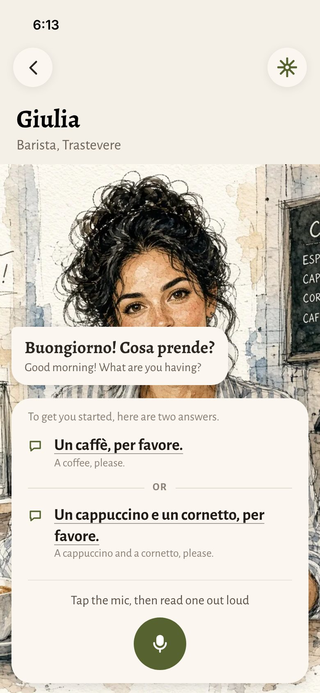
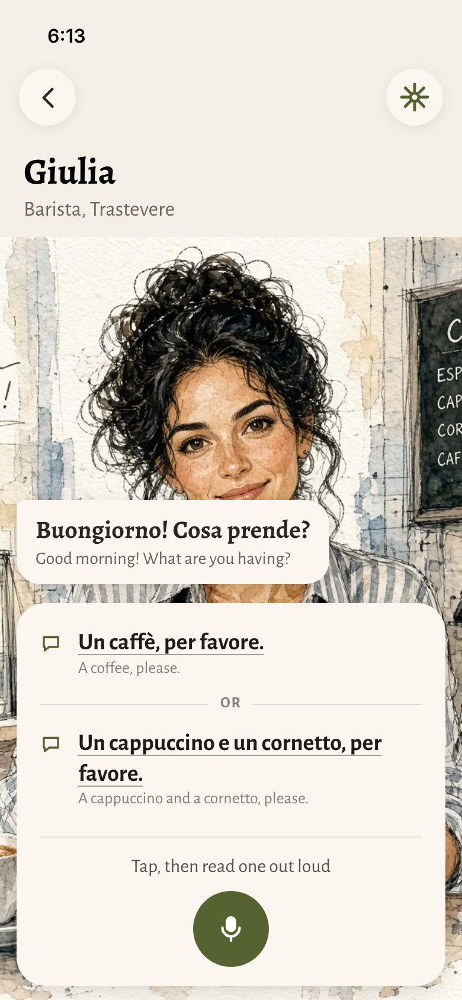
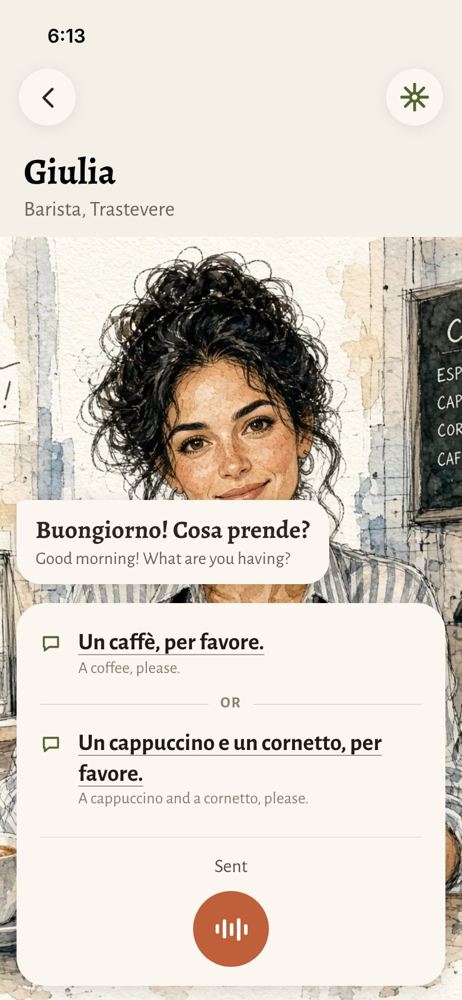

# Reply panel: read one out loud

2026-10-22 · Josh · Decided with the cloud session on the design canvas ("Reply buttons", row E: https://claude.ai/artifact/X2FsYUrGWzXzf2tJxBALBV). **Built 2026-10-22 (laptop)**: server `lib/scaffold.ts` (stages read, choose), app `ReplyPanel.swift` (replaces `ReplyButtons.swift`). Not yet played on Josh's iPhone; see Done means. Replaces the reply buttons in scaffolding ([beginner-scaffolding.md](beginner-scaffolding.md)).

**2026-10-23:** Josh's direction is to make "say it in English" the only scaffold in conversations ([beginner-scaffolding.md](beginner-scaffolding.md#say-it-in-english-the-one-scaffold-in-the-game-josh-2026-10-23-direction-to-test)). This panel stays until that's built and played.

## What Josh decided

After playing the reply buttons (Afuera, Marisol): "a success but some changes".
- **Tap-only goes** (stage A). It's too simple and doesn't prepare you for what comes next. The read-aloud stages stay as they are.
- **It wasn't obvious you have to tap the mic and read the line.** The instruction and the mic were far apart, and there was too much chrome.
- **No Pause here.** (Since the same evening, no Pause anywhere: [bottom-bar.md](bottom-bar.md).)
- **First time, more explanation**, in an onboarding-like bottom panel. **Answers as text, not buttons.**
- **The mic works exactly as it does everywhere else** (Josh: "the mic works the same way"): tap, talk (green), tap to send (terracotta), and what Whisper heard goes to the character. No matching against the answers, no highlight on the line read, no "Got it".

## The screens

Assets in `design/reply-panel/`: `E1.jpg` to `E4.jpg` (iPhone 390 × 844 pt at 2×) and their canvas sources `E1.dc.html` to `E4.dc.html` (exact sizes and colours; the portrait is a canvas upload, so the HTML doesn't render on its own).

| | Screen | Instruction above the mic |
|---|---|---|
|  | **E1 · First time** (the learner's first scaffolded turn ever): one extra line above the answers, "To get you started, here are two answers." | Tap the mic, then read one out loud |
|  | **E2 · Every later turn** | Tap, then read one out loud |
|  | **E3 · Talking**: the usual green circle with your sound wave ([bottom-bar.md](bottom-bar.md)) | Read one out loud, then tap to send (hands-free: Read one out loud) |
|  | **E4 · Sent**: the usual terracotta mic; nothing highlighted | Sent |

## Layout, top to bottom

1. **Her line**: unchanged, the cream bubble on the left (`Subtitles.swift`), then a gap (about 16 pt) that separates her from your turn.
2. **One panel** at the bottom of the screen, low (about 12 pt from the bottom edge), card colour, 24 pt corners, soft shadow. Inside:
   - **First time only:** "To get you started, here are two answers." Footnote size, muted.
   - **Answer 1**: a small speech-bubble glyph in green (`bubble.left`, about 16 pt) in its own column; the target-language line in Alegreya Sans semibold at title3 size (20 pt in the mock), ink, with the hairline underline already used on the reply buttons (1 pt, 40–45% of the text colour); the English under it, footnote, muted.
   - **OR**: a centred divider, small spaced capitals (caption2, bold, about 1 pt tracking, muted) with a hairline running out to each side. Josh: a plain "or" "looks like an accident".
   - **Answer 2**: as answer 1.
   - A hairline, then the **instruction**, centred, callout size, muted, then the **mic**, centred.
3. **No Pause** (there is none anywhere now: [bottom-bar.md](bottom-bar.md)) and no Learn link inside this state.

**Hierarchy is the point** (Josh: "things are too equal", "too messy"): her line (serif, in its bubble) > the answers (largest text in the panel, underlined) > the how-to (small, muted, by the mic). Answers are tight together; space separates the groups.

**The mic** is the conversation screen's one circle, centred under the instruction, with its usual states ([bottom-bar.md](bottom-bar.md): green mic, green wave while you talk, terracotta while sending and while she speaks). Only its position is new.

## Behaviour

- **Stages.** Drop `tap`: `STAGES` in `lib/scaffold.ts` becomes `read`, `choose` (one turn each in a learner's first three conversations, then the mic). Update `test:scaffold`. On `choose`, one answer fits and one doesn't, as today (`lib/replies.ts` → `writeChoice`); the character answers whatever was said, in role.
- **Sending.** The normal mic path (`stopRecording` → transcribe → `/v1/turn` with what was heard). Remove the `readingAloud` / `chosen` path that sent the tapped line without transcribing, and the "Read it out loud" chip.
- **First time.** The extra line shows on the learner's first scaffolded turn ever (a flag kept with the learner or in the app; it is not per conversation).
- **Accessibility.** VoiceOver reads each answer in the target language (`lang`), then the English. With VoiceOver on or the mic off, the answers become buttons that send the line (today's fallback, kept). AX5: the panel grows and the screen scrolls; nothing clips. Reduce Motion: no animation on the panel's arrival.
- **English** under the answers stays while scaffolding, as today.
- **Strings.** The instructions are English interface text (Swift is fine); the answers come from `/v1/replies` as today.

## Done means

Played in both countries on Josh's iPhone (Afuera: Marisol), first time and later turns, tap-to-talk and hands-free; AX5; VoiceOver; `npm run test:scaffold`, `test:replies-route`, `smoke:live` (both countries). Then this doc's status changes to built.
